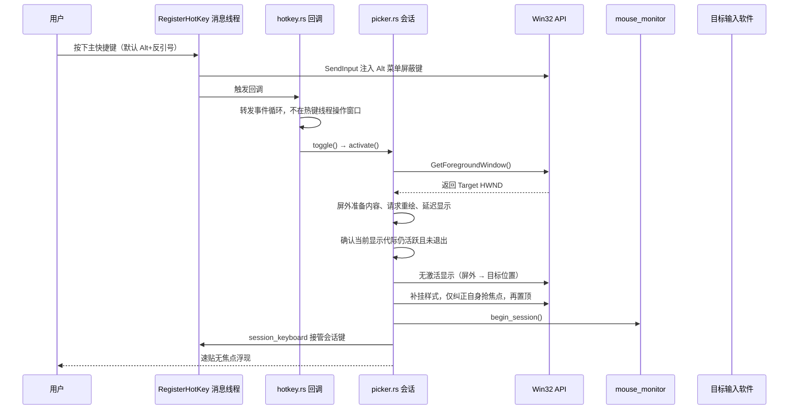
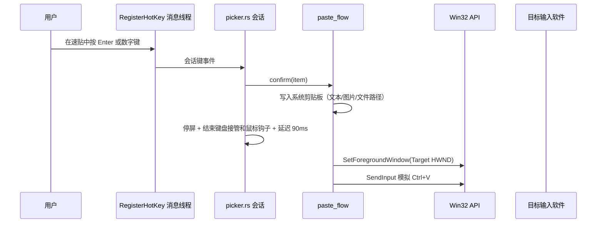

# 无焦点速贴窗口架构与防坑指南

> 活文档：记录速贴无焦点窗口的现行架构与踩坑结论，随实现更新。改窗口生命周期/焦点策略前必读（含 [ADR-0002](adr-0002-picker-docked-mode.md) 停靠形态的实施）。

## 1. 架构概述

速贴窗口（Picker）由全局快捷键（默认 `` Alt+` ``）呼出，并且**尽量不抢占当前正在工作的目标软件（如 Word、代码编辑器）的输入焦点**。用户在速贴中可以使用会话键（`Up / Down / Enter / Escape / 1-9`）、双击条目，或直接点击窗口外部结束本次速贴会话。速贴支持文本、图片和文件条目的展示与上屏，条目支持 Ctrl+Enter 次级上屏（执行该类别配置的默认动作），行内「⋯」打开[更多操作菜单](#速贴更多操作)，图片条目另支持悬浮大图预览。

当前实现（Slint 原生壳）的关键链路：

1. **五窗启动即建**：`main.rs` 启动即创建全部窗口（速贴/搜索/编辑/设置/悬浮气泡）。速贴/搜索/悬浮气泡平时屏外停屏、按需上屏（`overlay.rs`）；编辑/设置窗隐藏式停屏——Win32 真隐藏 + 平移屏外，Slint 端保持「已显示」，显隐走真实 `SW_SHOW`/`SW_HIDE`，任务栏按钮生灭由可见性驱动。全部窗口常驻，避免动态建窗的时序坑（见坑一、坑八）。
2. **智能定位策略**：根据设置优先贴近鼠标、上次关闭位置或目标窗口插入符位置，并在超出工作区时自动回收至可见区域。
3. **Win32 无焦点显示**：通过 `WS_EX_NOACTIVATE` 与无激活上屏避免抢占焦点，并在必要时立即恢复目标窗口。
4. **会话期键盘接管**：速贴显示期间由 `session_keyboard.rs` 经 RegisterHotKey 在专用线程上注册并转发会话按键（低级键盘钩子存在系统静默摘钩风险，不用于会话键分发），主快捷键与会话控制互不冲突，方向键支持长按连发。
5. **会话退出兜底**：低级鼠标钩子监听窗口外点击自动关闭，Esc 或再按主快捷键关闭并归还焦点；搜索窗口经独立热键或托盘菜单唤起。
6. **悬浮气泡**：全局单例轻量窗口，悬停 400ms 后显示条目预览（图片大图或文本摘要），跟随鼠标位置并自适应屏幕边缘定位，点击穿透。

速贴列表使用 104 逻辑像素的等高卡片：预览区固定 60 逻辑像素，文本按当前宽度和重字重裁到最多三行并对截断内容补省略号，图片缩略图等比容纳于 60×60 的区域。底部元信息固定一行，标签显示一个限宽名称及其余数量；来源名称在空间不足时省略。选中、收藏、标签变化、缩略图回填与菜单开合均保持行高不变，以便快速扫视和键盘定位；更长内容通过悬浮气泡查看。

顶栏显示当前主会话键与具体上屏动作（如「Enter 粘贴为原格式」）；更多操作菜单打开时改为「更多操作」，删除待确认时显示实际删除键位与关闭／取消键位。顶栏仍可拖动，不获取焦点；提示使用实际配置键位，不改变会话键语义。

### 快捷键设置与升级

全局快捷键默认由 Alt+反引号唤起速贴、Alt+Q 唤起搜索窗口。`globalShortcutsVersion` 为 1 时，仅将上一版默认速贴 Ctrl+反引号和搜索 Ctrl+Q 迁移到新默认；缺少版本的配置同时识别更早的速贴 Ctrl+Q／Alt+Q 和搜索 Alt+S／Win+F。其余自定义值保留；若候选全局键之间或与会话键冲突，整组保留原组合。迁移版本 2 在加载时持久化，升级后重新录制旧组合不会再次迁移。

设置页的全局快捷键注册状态与录制提示显示在对应输入框下方，允许换行并撑高行卡；会话键提示遵循相同布局，避免提示出现时输入框上移或被裁切。

速贴与搜索窗口共用会话键。顶栏、按钮悬浮提示、上屏动作目录、管理菜单和编辑窗口的入口引导均从当前设置生成；保存后立即更新缓存中的提示与动作目录，同时收起菜单、取消待确认删除。编辑窗口自身的 Ctrl+S 保存与 Esc 关闭为固定键位。

旧配置缺少 `sessionKeysVersion` 时只进行一次默认键位升级：次级上屏由 Shift+Enter 改为 Ctrl+Enter、编辑由 Ctrl+Enter 改为 Ctrl+E、收藏由 Ctrl+Space 改为 Ctrl+D，其余自定义值保留。迁移前按实际组合比较键位（忽略大小写、修饰键顺序与别名）；若候选键位与其他会话键或已启用的全局快捷键冲突，整组保留原键位，避免 Ctrl+Enter 的新旧用途相互占用。加载时持久化迁移版本，即使因冲突保留旧键位也不反复尝试；升级后用户可重新录制旧组合，保存与重启不再覆盖。

启动时先在事件循环内完成窗口句柄、样式、主题与表面装配，再注册全局快捷键。`hotkey.rs` 在报告注册结果前建立消息队列；重注册先同步注销并回收旧线程，避免组合键释放与新注册竞争。快捷键回调只向事件循环转发，转发失败与消息循环异常必须落日志；禁止在热键线程回调内调用注册或停止操作，以免等待自身退出。

### 速贴更多操作

所有条目的右上方只保留一个「⋯」入口，选中、悬停或菜单打开时显示，常态无描边、无底色；悬停与打开时出现轻描边和中性叠层。点击选中发起条目并在面板底部打开菜单，再次点击同一入口收起，不触发行上屏。所有条目常驻预留相同操作列宽，悬停与菜单开合不改变行高。

菜单上半部沿用条目的全部上屏方式，标注「仅本次」和实际配置的主／次级会话键；分隔线下固定为「收藏／取消收藏」「编辑」「删除」，同时展示实际快捷键。收藏更新列表星标，编辑沿用现有编辑窗口与返回路径。菜单过高时在窗口内滚动，方向键高亮项自动进入视口。

菜单打开期间，↑↓ 在上屏方式和管理操作间循环，Enter 执行高亮项；Esc 收起菜单，编辑和收藏快捷键收起菜单后作用于发起条目，删除键进入菜单内的两段确认。次级上屏与数字直达键只收菜单不上屏，避免浏览菜单时误触。点击其他条目先收菜单，不执行该次上屏。

### 速贴单条删除

速贴与搜索窗口共用「删除条目」会话键（默认 Delete）。首次按键或选择更多菜单中的「删除」，选中该条目、展开菜单并将删除项高亮，进入 3 秒待确认；菜单项显示红色「确认删除」，顶栏按「按键 + 动作」排列，例如默认设置下的「Delete 确认删除 · Escape 取消」，删除与取消键位随配置更新。时限内再次按删除键、点击该菜单项或在其高亮时按上屏键，沿用 `ClipService::delete` 删除条目；文件条目不删除引用的源文件。删除失败通过托盘提示，条目仍留在列表中。

Esc 先取消待确认，再按收起菜单，再按关闭面板；切换条目、移动键盘高亮、执行其他操作、重新打开或关闭菜单、列表重新查询及关闭面板也会取消。超时只解除确认，菜单保留。确认按条目 ID 与时限校验，异步缩略图回填不影响确认。

删除后菜单收起、面板保持打开，选中原位置的下一条；删除末项时选上一条，删空后显示空列表引导。

---

## 2. 核心实现逻辑与时序图

### 2.1 呼出速贴窗口（Show Picker）

1. **注入 Alt 菜单屏蔽键**（`hotkey.rs`）：含 Alt 的全局快捷键命中时（主、搜索默认组合均含 Alt），热键线程在转发回调前先 `SendInput` 一对未分配虚拟键（0xE8）的按下与抬起。`RegisterHotKey` 只吞掉组合键第二键的 keydown，Alt 的按下与抬起仍会送达前台窗口；当 Alt 比第二键先释放时，前台窗口只见 Alt 孤立的按下与抬起，其默认窗口过程据此次操作激活菜单栏（`SC_KEYMENU`）——不是速贴抢焦点，是原软件被带入菜单模式。屏蔽键让前台窗口在 Alt 释放前已见过另一个按键的按下，无论松键顺序都不再识别成单按 Alt；正常单按 Alt、Alt+Tab 与其他软件的菜单快捷键不经此路径，不受影响；前台为更高权限窗口时注入被系统丢弃，屏蔽不生效。注入必须在回调转发前完成：列表准备与窗口显示都在回调之后，等它们完成会错过 Alt 释放时机。
2. **记录当前活动窗口**：通过 `GetForegroundWindow` 记录目标窗口句柄（HWND）。前台属于开始菜单/搜索面板宿主（Win11 24H2 为 SearchHost 的「搜索」窗，另一形态为 StartMenuExperienceHost）时跳过记录——shell 窗口当插入符锚点与回贴目标都无意义（定位/还原/回贴动作对它全部无效）。
3. **解析显示位置**：开始菜单开着时不论模式统一改贴开始菜单边缘放置（速贴的 TOPMOST 压不过桌面 z-order 带之上的 shell 表面，落进其矩形必被整块盖住）：优先右侧、顶边对齐其顶边下方一个空隙，右侧放不下换左侧，两侧都放不下落更宽的一侧并钳进工作区——开始菜单保持打开，速贴在其旁边可见（`core::platform::windows::start_menu`）。其余情况按 `pickerPositionMode` 计算窗口左上角；`caret` 模式按「Win32 线程插入符 → UI Automation TextPattern → 鼠标」依次取值（见坑六），`lastPosition` 模式复用上次关闭位置（无记忆时退回光标所在工作区居中）。定位的**输入**是本次上屏的窗口物理尺寸，与 `set_size` 取自同一组数（有记忆用记忆，无记忆按设计尺寸 × 缩放折算），**不回读窗口**——首开时 `winit` 的 resize 尚未落地，读回的是装配期旧值。各定位分支都用该尺寸与工作区边界一起约束：窗口整块落在锚点所在显示器工作区内，光标贴边时翻到锚点上方或收进边界，工作区比窗口还小时退化为工作区左上角。锚点带**行高**（插入符锚点取插入符整行，鼠标锚点为 0）：翻到上方时窗口底边要让开整行再加空隙——只让空隙会把窗口压在插入符自己那一行上（实测输入框首行被切掉半行）。解析失败（仓储报错 / 工作区不可得）退回「贴光标 + 钳进工作区」，不把窗口留在屏外停屏位。尺寸与位置经单次 `SetWindowPos`（`window_control::set_window_bounds`）原子落地。从编辑器返回速贴（`restore_after_editor`）不走上述定位模式：停屏前落盘的几何按「上次位置」读回归位——鼠标/插入符锚点在编辑往返后已漂移，重算必然换位。
4. **无焦点显示**：窗口保持 `WS_EX_NOACTIVATE` 扩展样式；首次呼出与编辑返回都先在屏外设置尺寸、主题与内容，后台定位与底图准备遵循坑六的整段预算，再经 `schedule_reveal` 延迟移到目标位置（等待期与守卫见坑十四）。内容直接落在最终位置，不施加呼出位移动画；最小化恢复使用 `SW_SHOWNOACTIVATE`。
5. **前台恢复**：编辑返回在准备期开始时尝试归还会话目标；延迟显示时及随后 50ms 的样式补挂仅在前台被速贴自己占据时归还，保留等待期间用户主动切换的前台。样式补挂先归还前台再置顶，编辑返回同样启动置顶守护。
6. **启动鼠标外点监控**：`mouse_monitor.rs` 注册 `WH_MOUSE_LL` 低级鼠标钩子，检测用户是否点在速贴外部。
7. **接管会话键盘**：`session_keyboard.rs` 开始在专用线程上经 RegisterHotKey 转发 `Up / Down / Enter / Escape / Digit1..9`；按住方向键进入后台重复发射导航事件。
8. **搜索窗口协调**：主快捷键入口在准备期前收起活跃搜索窗；其他入口若捕获搜索窗为目标，在速贴实际显示并接管键盘时暂停搜索输入。

### 2.2 确认上屏与关闭窗口（Hide & Paste）

1. **写入剪贴板**（`paste_flow.rs` / `paste_support.rs`）：趁窗口存活先把条目内容写入系统剪贴板——`OpenClipboard` 需要存活的属主窗口，这一步必须先于隐藏（顺序不可调）。主动作与次级动作的格式能力解析、快照与恢复保护统一见 [运行行为](runtime-behavior.md#上屏执行)，窗口不自行分支决定发布格式。
2. **卸载会话能力**：取消会话键盘接管，关闭鼠标钩子。
3. **持久化当前位置**：只保存已实际显示的窗口几何；取消准备期或重复关闭时不保存停屏坐标，供 `lastPosition` 模式下次复用。
4. **隐藏速贴**：取消待显示定时器、结束活跃状态并屏外停屏。Esc/主快捷键关闭的 50ms 前台恢复仅在未重开、未退出且前台尚未交给其他窗口时执行；搜索目标同时恢复输入。
5. **延迟恢复目标并注入**：隐藏后等 `90ms`（`RESTORE_DELAY`）待前台稳定，按会话来源恢复目标应用（或重新打开搜索窗），再隔 `60ms`（`INJECT_DELAY`）用 `SendInput` 模拟 `Ctrl+V`；注入失败按恢复设置给出提示；可选在注入后恢复受序列号保护的原剪贴板快照。

### 2.3 窗口壳层与装配（现行）

- `main.rs` 负责启动顺序与模块间接线；各窗口模块（`picker.rs`、`search.rs`、`editor.rs`、`settings.rs`）自带 `wire()` 绑定回调，界面在 `ui/*.slint`。
- 界面事件（点击、悬停、输入）经 Slint 回调进入 Rust 会话模块，会话模块再调用 core 服务；反向状态通过各窗口的属性/模型更新。
- 悬浮气泡是独立轻量透明窗（`tooltip.rs` + `ui/tooltip.slint`），`WS_EX_LAYERED | WS_EX_TRANSPARENT` 实现点击穿透，不参与焦点管理。

### 悬浮气泡的触发与预览边界

- 以宿主窗口与条目 ID 标识悬停目标；首次进入等待 400ms，同一条目内移动只更新等待、加载阶段的锚点，不延后显示期限。显示后保持位置与内容稳定，避免重新查询、排版和淡入。
- 按钮提示以宿主、文案与按钮锚点标识目标，与条目预览共用一个窗口；切换目标立即收起旧气泡。离开目标、滚动列表、拖动搜索窗口或结束会话时取消显示；后台回填、显屏、渐显、置顶补挂与焦点补救均须校验请求和宿主活跃状态。
- 条目卡片宽度不超过 600、总高度不超过 480 个逻辑像素，并扣除所在屏幕工作区的柔影留边与安全间隙。文本排版限制为前 4096 个字符、32 个源行，再按可用高度裁排；截断时显示进入编辑查看的提示，保留元信息行。上屏仍使用完整原文。
- 文件条目逐项展示名称与弱化的单行父目录，目录过长时省略并显示截断提示，根目录保留整条路径；与文本共用字符、行数和高度上限，读取详情失败时回退列表摘要。底部数量将普通文件与文件夹分开统计，文件夹包含在存储的条目总数中，不能重复计数。
- 元信息时间标为「最近活动」，沿用最近使用时间、缺失时回退创建时间的口径；重新复制和上屏均会刷新活动时间，不应解释为首次复制时间。来源缺失时省略，过长时优先省略来源，保留类型、内容属性和时间。
- 图片按原始宽高比例适配可用空间；最长边小于 160 个逻辑像素时等比放大到 160，仍受可用宽高约束，极细边至少保留 1 个逻辑像素。元信息显示原始像素尺寸、大写格式名与已有文件大小（不可用时省略），图片与分隔线之间保留正文间距；解码失败时清空旧图并显示失败文案。预览只作查看，不承担交互式滚动。
- 条目以等待、加载结束时的鼠标坐标为锚点，按钮以自身锚点定位；越界先翻转，再钳制工作区四条边，包含负坐标副屏。

---

## 3. 踩坑记录与解决方案（Troubleshooting）

### 坑一：动态建窗叠加 Win32 干涉，容易渲染异常

- **现象**：动态创建窗口后立即修改无焦点样式/位置，内容区渲染异常（Tauri 时期表现为 WebView2 白屏或只剩边框；winit 下表现为首帧闪烁、边框暖屏）。
- **原因**：窗口创建、渲染首帧、Win32 样式修改都堆叠在冷启动阶段，打断渲染器初始化时序。
- **解决方案**：速贴/搜索/悬浮气泡启动即建，显隐走屏外停屏与位置切换（`overlay.rs`），不调用会触发销毁的 `hide()`；编辑/设置窗保持常驻，通过 Win32 真隐藏与屏外位置控制可见性，Slint 表面保持存活（见坑十）。

### 坑二：热键回调线程里做重活，容易死锁或丢键

- **风险**：在快捷键回调内注销热键可能等待自身线程退出；回调内操作窗口或执行耗时任务也会阻塞后续事件处理。
- **解决方案**：热键与钩子回调只做"转发"——回调线程尽快返回，窗口与会话操作回主线程执行（`hotkey.rs` 独立线程收 `RegisterHotKey` 消息）。

### 坑三：隐藏窗口后立即恢复焦点，容易触发窗口竞态

- **现象**：关闭速贴后偶发目标窗口没有恢复到最前，或下一个窗口没有稳定拿到焦点；外击关闭时还原前台会导致目标任务栏图标闪烁。
- **原因**：`hide`、上屏动画、`SetForegroundWindow`、`show` 挤在同一帧时，窗口管理器状态竞争。
- **关闭约束**：Esc/快捷键关闭后由事件循环定时器延迟恢复目标，须通过关闭代际与前台归属检查（见 2.2），不能让后台线程恢复旧前台。确认上屏走 `paste_flow` 的独立两段延迟（见 2.2）；**外击关闭不还原前台**，保留用户点击后取得的焦点。

### 坑四：无焦点窗口不会天然感知"点击窗口外部"

- **现象**：速贴不抢焦点后，应用内收不到可靠的失焦/点击事件。
- **原因**：窗口级事件只覆盖自身客户区，无法覆盖整个桌面坐标系，也无法判断点击落在别的应用窗口上。
- **解决方案**：`mouse_monitor.rs` 用 `WH_MOUSE_LL` 捕获鼠标按下，结合 `GetWindowRect` 判断点击点是否在速贴边界外；落在外部则异步关闭。带柔影留边的浮层（速贴、托盘菜单）命中矩形按留边内缩（`begin_session` 的 `inset`）：那圈透明区在 Win32 里仍属窗口、会吞点击，按可见卡片判定才不会在阴影上点出「没反应」（见坑十二）；速贴留边为 4 逻辑像素，传入前按窗口缩放折算为物理像素

### 坑五：多窗口切换的清理逻辑分散，容易顺序不一致

- **现象**：窗口切换或关闭返回时，偶发会话键盘未释放、鼠标钩子未关闭、目标窗口恢复时序错乱。
- **原因**：清理逻辑分散在不同回调点，容易遗漏共享状态收口。
- **解决方案**：窗口切换与关闭返回统一由 Rust 侧一处收口，固定顺序「结束键盘接管 → 停止鼠标监控 → 隐藏 → 延迟恢复/打开目标窗」；速贴确认上屏的收尾与编辑器关闭返回来源窗口都走这一模式。

### 坑六：插入符定位不是所有应用都稳定可读

- **现象**：浏览器、Electron 应用、WinUI/UWP 程序里速贴几乎总是贴不到文本光标，一律退化成鼠标位置——而这些恰是日常最常用的输入环境。
- **原因**：分两层，缺一不可。
  1. `GetGUIThreadInfo` 只能读到调用 `CreateCaret` 的应用的插入符（原生编辑控件、部分 Win32 程序）。现代应用普遍自绘光标（不调 `CreateCaret`），其线程 `hwndCaret` 恒为空，Win32 侧一无所获。
  2. UIA 兜底也不能直接取插入符范围的几何：插入符范围是**退化（零长）范围**，而 `GetBoundingRectangles` 对退化范围按设计返回**空数组**。必须先把范围展开到某个「文本单元」再取几何。
- **UIA 侧的反直觉点**（都是「范围几何不可尽信」的不同侧面，`uia_caret.rs` 逐条对应）：
  1. **折叠与否不能看矩形空不空**，要用 `CompareEndpoints(Start, self, End) == 0` 判端点重合。VS Code 的 EditContext 宿主对折叠范围照样返回**整行矩形**（实测 `[[1358,811,963,23]]`），照矩形取边会把整行右沿当插入符，速贴飞到文末一千多像素外。
  2. **展开粒度不能只认字符级**：插入符后面的字符是空白（行尾正是这种情形）时字符级矩形为空，得放大到 `TextUnit_Word`/`TextUnit_Line`。故按 `EXPAND_UNITS = [Character, Word, Line, Paragraph]` 由小到大逐级尝试，任一级拿到可用几何即停。
  3. **要拒绝「整个元素大小的矩形」**：Chromium 对空输入框返回整个编辑器框、VS Code 返回整行——这类几何分辨不出插入符落在哪，当锚点用会把速贴甩到元素右下角。`covers_element` 比对焦点元素包围盒（四边 ±1px），命中即弃（连元素框都读不到时不拒绝，避免校验本身成为新的失败源）。
  4. **探针起点在插入符之后 ⇒ 探针是「下一个单元」，几何与插入符无关**。CodeMirror/Obsidian 的 `ExpandToEnclosingUnit` 从位置 P 展开总是给出 P **之后**的单元：行中时是下一字符（左沿恰好等于插入符 x，碰巧正确），**行尾/段尾/文末**时跳过本行尾空白直接落到下一行行首甚至页面页脚（端点比较为负，实测文末探针是右下角「0 条反向链接」）——照探针取边就是「行中正常、行尾乱跳」。识别出这种探针后改取**上一条视觉行**的末块右沿（以探针起点为界 `Move(Line,-1)` 回退一行再展开），实测所有内容行行尾与文末锚点都精确落在行尾。
  5. **软换行边界的探针端点比较为 0**（伪装成正常「贴起点」），只能靠几何识别：探针落在跟随段落的**非首条视觉行**上即为软换行边界，同样改取上一条视觉行的右沿；段落首行上的探针是真行首/行中，照常取探针左沿。
  6. **`Move` 在插入符范围的克隆上会虚报移动量**（返回 -1 但位置没动），在探针派生的范围上才语义可靠——回退一律基于探针范围做，不碰插入符克隆。
  7. **有些字段级焦点根本没有范围几何**。Obsidian 空搜索框：插入符范围在字符/行/段粒度上非折叠但矩形为空、词粒度保持折叠；Obsidian 内联标题（点击标题进入编辑）：焦点元素是**无 TextPattern 的容器**，根文档的插入符范围也落在 0 且无几何——范围路径对这类插入符一无所获，但插入符就在焦点元素框内，故 `field_rect_anchor` 用焦点元素框**底边**兜底，水平位置分两档（2026-09-27 拍板）：空文本字段（Value 只含空白，ZCode/夸克输入框）的插入符确定在文本起点，取框**左沿**、窗口左上角对齐锚点——与「有字时贴插入符列」一致，空框打第一个字窗口几乎不动；文本非空或读不出 Value 的（VS Code 行带，插入符可能在任意列）取底边**中心**——provider 给不出插入符列位置时，行带中间才是「贴着这一行」的预期位置，左沿会压住行号栏/输入框左端。守卫：元素框必须是目标窗口客户区内的真子矩形（Chromium 会把滚动区外坐标算进元素框，实测编辑器文档框 bottom 比窗口底低 488px），且不得≈整个客户区（焦点散在整页时框与插入符的相对位置无从谈起），不满足则照旧回退鼠标。
  8. **有些 provider 把字段/页面大框直接当成一个文本单元的几何**。实测 Chrome 新标签页搜索区（字段框兜底拿到 1007px 高的框）、夸克新标签页搜索框（选区范围拿到 143px 高的矩形）：框是真的、也通过「真子矩形」守卫，但真实插入符行只有 ~10-60px，大框的边沿不是插入符位置——照用会把速贴甩到框底甚至屏幕底。守卫是**行高上限**（`MAX_CARET_LINE_HEIGHT = 100` 物理像素）：UIA 链内所有锚点出口（范围几何/字段框/下钻候选）就地过滤，让兜底链继续跑（见反直觉点 13），外层 `usable_probe` 只做最终把关、超限即弃回退鼠标。
  9. **范围几何会带进相邻元素的块——折叠与非折叠一视同仁**。实测夸克搜索框（折叠插入符）字符/词/行展开都返回**整条输入行**（≈元素框），段展开返回三块：输入行 + 上方 216×143 的图标容器块 + 下方按钮块；VS Code 段展开带进别行的 emoji 块。越界块当末块/行块取会把锚点甩出输入行（夸克曾恒落图标容器右下角 `(1719,797) 行高=143`），还会把软换行判定与上一行回退带偏。`blocks_within_element` 对**所有**范围几何（选区、各级展开、上一行回退）先做元素框垂直重叠过滤，插入点必在焦点元素框内；全被过滤时回退原数组（过滤不成为新的失败源）。
  10. **行级 provider 会丢列位置**。VS Code 的 EditContext（`native-edit-context` 元素）把整行矩形当唯一几何：字符/词/行展开全给同一块整行矩形（恰等于元素框，被 `covers_element` 拒掉），锚点落到字段框兜底恒在**行首**——y 对、x 与插入符列无关。这是 VS Code **屏幕阅读器优化模式关闭时**的形态：`editor.accessibilitySupport` 为 `auto`/`off` 时 Chromium 对 EditContext 折叠范围一概回整行带，列位置在 provider 几何里不存在，无客户端侧办法（连元素级属性 `UIA_CaretBoundingRectanglePropertyId`=30095 都不给——实测返回 `VT_I4` 而非矩形数组）。开启屏幕阅读器优化模式（命令面板「切换屏幕阅读器辅助功能模式」，写入 `editor.accessibilitySupport: "on"`）后，VS Code 响应 EditContext 的 `characterboundsupdate` 事件上报逐字符与选区几何，`GetSelection` 折叠范围**直接返回 1px×行高的插入符条**（实测列 1 → `[1312,1099,1,20]`、行尾列 36 → `[1639,1107,1,20]`，x 精确跟随光标列），现有 `caret_bar_anchor`/行探针端点路径无需改动即命中（实测锚点 `来源=选区范围 点=(1639,1127) 行高=20` 贴行尾）。部分情形下不开屏读模式**段**展开的多块几何里也藏着插入符条本身（实测 `[836,415,1,17]` 的 1px 竖条与整行块 `[836,414,331,20]` 同现；并非总在——实测另一版本的行中展开只有行带、无窄条，此时锚点落行首而 y 恒对）：`caret_bar_anchor` 在每个粒度的展开结果里先查「窄条」（宽 ≤2px、高 ≥8px；多条窄条时取最右——行号栏装饰条在文本区左侧，插入符条跟着插入符走），配对的**行带取与窄条 y 重叠的所有宽块（宽 >8px）的纵向并集**——同一视觉行的文本块与 emoji/图标块高度不同（实测 16px vs 20px），取单块会把行底与行高都带偏。命中即取窄条 x + 行带下沿/行高，并**优先于任何行级锚点**（逐粒度扫完才落行级兜底）。诊断见 `crates/floatpaste-core/examples/uia_caret_probe.rs`（`dump <进程名>`，同时 dump 全局焦点元素与窗口根的文本元素树）。
  11. **软换行是局部现象，隔远了就是跨元素垃圾**。段展开带进顶部 breadcrumb 块时（实测 VS Code 根文档段展开首块 `[1313,331,64,17]` 离光标行 365px），探针看似落在「段落非首行」上，软换行误判触发上一行回退、一路失败后落到别处的字段框兜底——锚点甩到窗口顶部。守卫：探针与段落首块的间距超过 3 个首块行高（`SOFT_WRAP_MAX_LINE_SPANS`）不判软换行。另外回退上一行失败（`Move` 不动/拿不到几何）时**退回探针自身几何**：探针行就是插入符自己的行（实测 VS Code 空行的字符展开即整条空行），其左沿正是插入符位置。
  12. **焦点元素可以是「跟丢光标行的条带」**。VS Code 的 `GetFocusedElement` 常返回一个跟随光标行的 ~23px 条带：无 TextPattern、自身也无文本后代，字段框兜底给出行对列失的锚点；且**点击后立即开窗时条带矩形会陈旧**（还停在上一条光标行，实测锚点偏出 345px）。对策：焦点条带的后代下钻无果后，**改从窗口根下钻**搜文本元素——根文档的 `GetSelection` 给的是实时光标行几何，不随条带陈旧。
13. **坏锚点要拦在链内，不能只靠外层一票否决**。实测夸克新标签页搜索框首贴：provider 首查（页面可访问性树刚构建）返回非折叠选区、几何只带 143px 高的图标容器块（锚点 `行高=143`），外层行高校验把它连同整条 UIA 路径一起否决、直接回退鼠标——而紧随其后的字段框兜底本来能给出正确锚点，这正是「第一次贴错、第二次才对」的根源（第二次查询起树已热，范围恢复折叠）。行高超限的锚点在 `anchor_from_range`/`field_rect_anchor` 出口就地过滤（`trusted`），范围路径的失败顺延到字段框兜底，首贴即正确。
14. **焦点归属失真有三种形态，都不给锚点**。Chromium 开 IME 输入捕获窗时，`GetFocusedElement` 返回的是**整虚拟屏大小**的 `IHWindowClass`「Input Capture Window」而非真实文本框（形态一）；焦点被报在**窗口内某个无关容器**上（形态二，ZCode 空输入框实测：对话区容器，第二级下钻候选的字段框兜底把锚点猜到 `(1288,673)`）；焦点元素**本身就是无关文本元素**（形态三，ZCode 实测：对话气泡持有 TextPattern 但无范围几何，字段框兜底曾把锚点给到气泡框——Chromium 把 UIA 焦点报在「最后交互的元素」上，与键盘焦点脱钩）。文档级 `GetSelection` 是全文档共享的**陈旧插入符**（ZCode 实测：所有文本元素的段展开都带同一对块；输入框刚敲过字时「最后已知插入符」碰巧就在输入框内，表现为有字位置对、空框位置错）。对策分三层：焦点元素是 IME 输入捕获窗（`IHWindowClass`，按类名判）时整条 UIA 路径不给锚点、回退鼠标——判据**不能**用「焦点元素框须在客户区内」的几何：Chromium 把滚动区外坐标也算进编辑器元素框（反直觉点 7 实测：Obsidian 文档框 bottom 比窗口底低 488px），超界框是合法焦点，按几何拦会把 Obsidian 长文档整条 UIA 路径判死、恒回退鼠标（2026-09-27 回归）；放宽条件的下钻候选（无焦点背书）范围几何拿不到时**不给字段框兜底**；焦点元素**自己有 TextPattern** 时字段框兜底仅限确证的空输入框（Value 只含空白——contenteditable 空态的 Value 是一个换行符，ZCode 输入框实测 `'\n'`；对话气泡无 ValuePattern，天然被排除）。放宽候选的选区几何仍采信（VS Code 根文档依赖它给实时光标行），陈旧值经它漏进来的形态若再发，再收口。
  另外两条硬性约束：插入点夹在展开单元内部（如行中间的词）时水平位置无从得知，端点比较判不出归属就不给——拿单元边缘当锚点会偏出一整行；取「贴起点/贴末端」一侧的探针仍要求**恰好一块矩形**（展开跨元素边界的多块垃圾几何如 Chromium 文末实测 `[[410,349,1,1],[322,390,900,60]]` 即弃），只有「上一条视觉行」路径允许多块取末块。
15. **空字段的 `GetSelection` 是文档级共享选区，不是本字段的插入符**。实测 VS Code 搜索视图替换框（空、插入符在起点）：字段自身带 TextPattern，但 `GetSelection` 返回的是全文档共享的最后已知选区（探针实测窗口内全部文本元素返回同一几何，正是反直觉点 14 那份「陈旧插入符」），「选区范围」路径照单全收会把锚点甩到编辑器/搜索部件的旧选区上（实测锚点恒落 `(1292,433) 行高=36`，与替换框无涉）。确证的空文本字段插入符必然在文本起点，无需几何：`element_caret_anchor` 入口先查 Value（只含空白即空字段），持焦点时直接给字段框左沿锚点、整段跳过范围路径；放宽候选（无焦点背书）的空字段同样不给。非空字段不在其列——它自己的选区仍可能真实，照旧走范围路径。
16. **探测时长会随空闲时间变长，显示必须有整段预算**。UIA 链包含多次跨进程往返，连接超时 150ms / 事务超时 300ms 只约束单次调用；常驻 `uia-probe` 线程的 250ms 等待只约束插入符探测，不能覆盖开始菜单几何、GDI 抓屏与模糊烘焙。速贴首次呼出和编辑返回应通过 `picker-prepare` 后台任务准备定位与底图，界面线程用定时器轮询，禁止同步等待结果。从显示入口起计，准备结果仅在 150ms 预算内且显示代际仍活跃时采用；超时或后台任务不可用时，普通呼出回退到提前取得的鼠标位置，`lastPosition` 与编辑返回保留提前约束到工作区的记忆位置，底图统一回退当前主题实底。不得在上屏后采用迟到结果挪窗或替换底图。预算只约束后台准备的采用时限，不保证系统调度、同步列表裁排或首帧呈现的总耗时。回退原因记入呼出日志的 `reason` 字段：`deadline` 超过采用期限、`worker_unavailable` 准备任务不可用、`worker_disconnected` 结果通道断开。
17. **探测线程要独占一份 UIA 客户端**。COM 对象按线程缓存；插入符探测使用常驻 `uia-probe` 的 MTA 客户端及跨进程连接，开始菜单几何探测使用所在准备线程的客户端。`picker-prepare` 同时只允许一份任务；系统调用未返回时，新呼出直接走回退，避免积压线程。任务在定位前与抓屏前检查显示代际和预算，跨线程只传坐标与原始像素，Slint 图像仍由界面线程创建。
- **解决方案**：`caret_point_for_window` 两层依次尝试（`picker_position.rs` → `uia_caret.rs`）。UIA 探测跑在常驻 `uia-probe` 线程，客户端按线程缓存，连接超时 150ms、事务超时 300ms，调用方最多等 250ms；速贴的采用期限和后台准备约束见反直觉点 16–17。两层结果均经 `usable_probe` 校验桌面坐标与行高，不可得时回退鼠标。范围几何先过滤焦点元素框的垂直重叠，插入符窄条优先于行级兜底；边界插入符取上一视觉行的末块右沿，回退失败沿用探针。字段框兜底与翻到上方时让开整行的规则保持一致。
- **下钻后代**（焦点元素没有任何 TextPattern 时）：部分应用把 UIA 焦点报在无 TextPattern 的容器/窗口根上，真正的文本编辑框在其后代里，此时对文本框调 `GetCaretRange`，provider 给出的就是真实插入符。触发条件是焦点元素**既无 TextPattern2 也无 TextPattern**——焦点元素自己有 TextPattern 但几何拿不到的（如 Obsidian 空搜索框）不下钻（焦点已在文本元素上，下钻无意义），照旧走字段框兜底。搜索用 `FindFirstBuildCache(TreeScope_Descendants)`，条件两级从紧到松：先「`HasKeyboardFocus` 且支持 TextPattern」的 AND 条件，搜不到再放宽为只「支持 TextPattern」；**焦点元素自身搜不到候选时再从窗口根元素搜一遍**（反直觉点 12：VS Code 的 EditContext 宿主条带自身无文本后代，窗口根的文档元素才有实时光标行选区）。候选的 ClassName/Name 经 CacheRequest 随查找一次带回，读取零额外跨进程往返。命中候选后复用同一套定位（GetCaretRange → GetSelection → 字段框兜底），字段框的「客户区真子矩形」守卫继续生效；候选不再二次下钻（候选已按支持 TextPattern 筛过，病态 provider 上再下钻只会把搜索递归下去）。护栏：下钻是跨进程扫树，跑在 `uia-probe` 线程上、调用方只等固定上限（见反直觉点 16）；UIA 客户端创建时同步 `SetTransactionTimeout(300ms)`（事务默认超时可达数十秒，与连接超时 150ms 一起收紧），provider 卡顿不拖死开窗。
- **失败现场日志**：UIA 定位最终失败时补采一轮轻量现场、一次 `tracing::debug!` 输出——焦点元素的 ClassName、ControlType（数值）、Name（截断 40 字符、控制字符折空格）、CurrentBoundingRectangle，TextPattern2/TextPattern 有无，支持 TextPattern 时的选区数量与首选区是否折叠，下钻是否触发及命中的候选摘要。只在失败路径执行，成功路径零开销。
- **仍读不到的情形**（此时照旧回退鼠标）：目标窗口已不是前台窗口（UIA 的「焦点元素」是全局概念，此时读到的是别的窗口的插入符，故直接判失败）；焦点元素是 Chromium 的 IME 输入捕获窗（`IHWindowClass`，按类名判，反直觉点 14）；自绘光标且不实现 TextPattern 的应用（部分终端、游戏）；提权窗口与当前进程跨完整性级别（UIPI 拒绝 UIA 调用）。
- **剩余缺口**（以下情形仍读不到，回退鼠标或字段框兜底）：搜索条件只认「支持 TextPattern」的后代，provider 不报告 TextPattern 可用性的自绘文本框（部分终端、游戏）下钻也找不到；`FindFirstBuildCache` 只取条件命中的**第一个**候选，同一窗口有多个文本框时可能选中错误的那个（第一级「HasKeyboardFocus」条件尽量压低概率）；候选命中后范围几何与字段框守卫都不过的，仍回退鼠标。

### 坑七：透明窗口圆角穿帮（背景遮挡与外阴影裁切）

- **现象**：透明无框窗口四周出现直角尖角，与圆角卡片冲突。
- **原因**：两类问题叠加——① 窗口背景未完全透明，实色填掉了圆角外的区域；② 外阴影超出窗口边界被系统裁切，四角最明显。
- **关键结论**：圆角"变尖"不一定是圆角失效，先区分"背景遮挡"还是"外阴影裁切"。
- **现行方案**：窗口设为全透明，卡片圆角与描边由 Slint 自绘。速贴使用 4px 留边内的短影，并通过 `use_client_side_shadow` 取消窗框扩展与 DWM 系统圆角请求，保留非客户区渲染；不依赖窗口外的大范围系统投影。悬浮气泡和托盘菜单也在各自留边内绘制投影，保留 winit 的透明合成与默认非客户区策略（见坑十二）。
- **快速排查**：临时去掉阴影类样式，尖角立即消失即为外阴影裁切；再交叉核对窗口透明与背景色设置。

### 坑八：winit 置顶与窗口生命周期耦合

- **现象**：置顶位有两类失效——winit 异步样式重排/系统操作把 `WS_EX_TOPMOST` 剥掉，或另一个置顶窗口在速贴之后抬升（topmost 带内后来者在上有权盖住速贴）。
- **置顶约束**：速贴、搜索、悬浮气泡与托盘菜单必须在 Slint `Window` 上声明 `always-on-top: true`，让 winit 内部窗口层级与 Win32 置顶操作保持一致；不要只靠外部 `SetWindowPos(HWND_TOPMOST)`，否则样式重排会按普通窗口状态覆盖置顶位。会话期置顶守护（`picker.rs` 的 `TOPMOST_GUARD`）在速贴激活期间每 500ms 检查置顶位，失效即重抬，会话结束停表，仅在事件循环线程触达。
- **原因**：winit 对置顶/激活状态的管理与窗口存活及异步样式重排耦合；窗口销毁会连带撤销关联状态，销毁重建则丢失首建时建立的 Win32 修饰。
- **生命周期约束**：五窗启动即建、全程常驻；速贴/搜索/悬浮气泡显隐不调 Slint `hide()`，编辑/设置窗隐藏式停屏（Win32 真隐藏 + 平移屏外，见坑十）。
- **对停靠面板的约束**：任何新增常驻窗口形态（见 [ADR-0002](adr-0002-picker-docked-mode.md)）都先在本坑结论上做 spike，验证不回退内存优化成果。

### 坑九：FRAMECHANGED 的 SetWindowPos 缺 NOACTIVATE 会激活 NOACTIVATE 窗口

- **现象**：tooltip/速贴每次上屏，宿主窗口边框微微闪烁一下；无其他窗口聚焦时速贴面板自身被莫名抬成前台。高频采样 `GetForegroundWindow` 可见前台翻转「宿主 → tooltip → 宿主」两组——`WS_EX_NOACTIVATE` 挂着也拦不住。每次「抢—还」都是宿主激活状态翻转，DWM 随之重画边框，即「边框微微闪烁」。
- **原因**：`window_control::remove_window_system_menu` 的 `SetWindowPos` 带 `SWP_FRAMECHANGED` 但缺 `SWP_NOACTIVATE`，缺省激活语义对 NOACTIVATE 窗口依然生效——`WS_EX_NOACTIVATE` 只拦鼠标点击激活，拦不住程序化激活。又因 winit 会异步把 `WS_SYSMENU` 带回窗口样式，每次剥除都有净变化、每次都把浮层抬成前台；该调用在 tooltip 的 `present` 同步段与 `after_show` 的 50ms 兜底里各跑一次，恰对应观测到的两组「抢—还」。winit 样式重置的落地时序不定，`WS_SYSMENU` 是否被带回决定剥除有无净变化，故现象时隐时现。
- **解决方案**：① 样式类 `SetWindowPos` 一律显式带 `SWP_NOACTIVATE`（`remove_window_system_menu` 即此类，一处约束全体浮层受益）；② 停屏浮层的几何变更走 `window_control` 的裸 `SetWindowPos`（`set_window_bounds` / `set_window_position_no_activate` / `set_window_size_no_activate`），不经 Slint/winit 的窗口几何 API——框架会附带 flags 重排、异步投递等额外语义，停屏浮层需要单一确定的「只动几何、绝不激活」。归还前台的前台策略（`overlay.rs` 的 `ForegroundPolicy`）保留作防御，正常路径不再触发。
- **排查方法**：黑盒对照实验（框架路径与裸 API 路径重放）可能被并发因素混淆；逐调用记录前台快照，区分几何变更和样式剥除的影响，再定位发生激活的具体 API。

### 坑十：任务栏按首次可见时的样式分类，事后翻 TOOLWINDOW 修正不可靠

- **现象**：编辑/设置窗用「常驻可见（停屏屏外）+ TOOLWINDOW 开关」控制任务栏按钮生灭：首开按钮缺席、第二次起才出现；把 TOOLWINDOW 挂载提前到首次 show 之前后，恶化为首开与后续**全部**无按钮。重发 `WM_SETICON`、补写类图标、把按钮创建挪到窗口线程空闲时刻，均无效——与图标查询、窗口线程忙闲全无关。
- **原因**：任务栏（Win11）在窗口**首次可见的瞬间**按当时的扩展样式做「上/不上任务栏」一次性分类，之后对常驻可见窗口翻样式位的重分类不可靠。首秀瞬间带 TOOLWINDOW → 被归入「跳过任务栏」且长期不修正（永远无按钮）；首秀瞬间裸样式 → 分类为上任务栏，但按钮创建被随即到达的 TOOLWINDOW 中止，模型带伤（首开无按钮，首次激活后才修复）。另注：winit 会在 `set_visible` 等路径全量重写样式位（`apply_diff` 的 `SetWindowLongW(GWL_EXSTYLE)`），show 前手工挂的样式随时可能被冲掉。
- **解决方案**：弃样式翻转，按钮生灭由真实可见性驱动（`win32_ext::set_window_visible` 的 `SW_SHOWNOACTIVATE`/`SW_HIDE`）：扩展样式从创建起恒为普通 `APPWINDOW`；装配时 show 前写图标并移屏外（首次可见发生在屏外、形态已终），show 后立即隐藏进入停屏；打开/关闭走真实显隐。隐藏对 Slint 不可见（Slint 保持「已显示」，表面存活；winit 的 wndproc 不处理 `WM_SHOWWINDOW`，外部 SW_HIDE 无副作用）。
- **停屏浮层的同源约束**：`silent_assemble_parked` / `silent_assemble_focusable` 同样必须在 show 前先停屏，避免窗口从屏内默认位置首次显示。停屏不依赖 HWND：Slint/winit 在尚未建窗时缓存位置，不能因句柄不可得而推迟到 show 后，否则延迟建窗路径还可能在取句柄失败时跳过停屏。L2 检查延迟建窗后的初始几何；E2E 在首次主动打开速贴前采样主实例业务窗口的可见性和位置。几何采样不保证捕获 DWM 的每一帧，不能替代连续帧视觉验收。
- **约束与排查**：让窗口的**首次可见即最终形态**（样式、图标、位置），运行期只动可见性不动样式；「第一次坏、第二次好」时检查 shell 侧首次分类与窗口侧状态。先区分按钮存在与否和按钮内容是否正确，两者是不同链路。

### 坑十一：无焦点窗拿不到 DWM Acrylic 的玻璃感——模糊是激活态特权，Acrylic 档速贴自绘烘焙

- **现象**：速贴挂 `DWMWA_SYSTEMBACKDROP_TYPE=Acrylic`：从未激活的窗口挂载恒平色；激活过再失活的窗口只剩「无模糊的半透明」——条纹振幅实验（8px 周期黑白条纹垫底测列均值振幅）：激活态 8.4（模糊涂抹）/ 失活态 29.1（条纹锐利透出）。Acrylic 的高斯模糊只在激活态渲染，热键唤起的速贴（NOACTIVATE 常态失活）永远没有玻璃感。SWCA accent（`ACCENT_ENABLE_ACRYLICBLURBEHIND`）在 Win11 上挂载成功也不产生模糊（仅剩 tint），从未激活窗上该调用直接失败。
- **原因**：Win11 DWM 的 Acrylic 模糊是激活态特权（失活窗口走廉价合成路径：保留半透明采样、去掉模糊）；SWCA accent 老管线在 Win11 上被系统收紧。正确出路是「自己画模糊」而非「换条 DWM 管线」。
- **解决方案**：速贴模糊底自绘（`core::backdrop` 纯逻辑 + `platform::windows::screen_capture` 抓屏）：每次唤起在移回屏内前（窗口尚停屏，抓不到自己），抓取目标位屏幕区域（BitBlt+CAPTUREBLT，四周外扩一个模糊半径，范围钳到虚拟桌面——桌面之外 BitBlt 填不透明黑，贴屏边唤起会把黑边糊进底图，钳制侧的 clamp 随之落在屏幕边界）→ 三遍 box blur 近似高斯（半径 30 逻辑 px × 缩放因子，饱和玻璃档——半径过小时复杂背景高对比结构只糊边不成雾，留下一团团可辨识色斑）→ 裁回卡片尺寸（速贴窗口内缩四周 4px 留边，抓屏原点同步内缩；边缘模糊吃到窗外内容，滑窗图像边界 clamp 会让四边比中心更「实」）→ `material-layer` 同源 tint（圆角烘焙进图 alpha，规避软渲 clip 不按圆角裁剪 slint#4176）→ `blur-backdrop` Image 铺 card 底（z 序最底层）。抓屏失败（锁屏/会话切换）回实底。烘焙服务设置项「背景材质」的 Mica/Acrylic 两档，分派收口在 `picker::prepare_picker_backdrop`（每次唤起现读设置），以 tint 深浅分档：Acrylic 档 tint=`backdrop::ACRYLIC_TINT_ALPHA` 0.80、深色 tint 仅在暗背景提亮、随背景变亮渐退，以兼顾暗部层次与亮背景去白雾、行卡半透玻璃卡；具体分层与投影约束见 [主题系统](theme-system.md)；Mica 档 tint=`backdrop::MICA_TINT_ALPHA` 0.92 近不透明（Mica 材质本身不透明）、行卡不透明实卡细描边（玻璃卡叠此实底塌层）；「无」档实底（浅 `canvas-default` 近白面板 + `surface` 白卡 + 完整描边与柔影，深 card-layer 近黑）。可激活窗口（搜索/编辑/设置）的档位分流见 [主题系统](theme-system.md)，决策依据见 [ADR-0005](adr-0005-window-material.md)。已知限制：底图是唤起瞬间的静态快照，背后内容动态变化不跟随（瞬态面板可接受）；会话中改明暗主题，在屏底图 tint 不实时跟随（下次唤起重烘焙自愈）。
- **教训**：判读「材质活不活」必须区分两个维度——透底（白黑垫底差分）与模糊（条纹振幅），只测差分会把「无模糊的半透明」误判为活；竞品效果归因要落到实现层（玻璃感可能来自网页层自画而非系统材质）；无焦点窗的观感需求最终要靠自绘兜底。另：黑白两轮差分判据对「条纹垫底」失效（两种条纹模糊后均值同为 50% 灰，差分恒 0），垫底判据用整块纯色、模糊判据用条纹，两种图案别混用。

### 坑十二：禁用 DWM 非客户区渲染会露出经典边框

- **症状与检查**：托盘菜单或悬浮气泡的透明留边外出现直角灰白硬框时，先核对装配是否写入 `DWMWA_NCRENDERING_POLICY` 与窗口样式；不要把硬框当成柔影调色问题。策略值 USEWINDOWSTYLE=0 / DISABLED=1 / ENABLED=2。读取当前非客户区渲染状态应使用 `DwmGetWindowAttribute(DWMWA_NCRENDERING_ENABLED)`，返回值是 BOOL；`DWMWA_NCRENDERING_POLICY` 用于写入策略，不能作为读取属性（[Microsoft API 说明](https://learn.microsoft.com/en-us/windows/win32/api/dwmapi/ne-dwmapi-dwmwindowattribute)）。
- **原因与边界**：winit 的「无边框」窗口仍可保留 `WS_CAPTION | WS_THICKFRAME`，通过 `WM_NCCALCSIZE` 处理非客户区；`DWMNCRP_DISABLED` 禁用整个非客户区渲染，不能当成仅关闭阴影的开关。带框样式下可能露出经典边框。透明合成由 winit 的 `DwmEnableBlurBehindWindow` 管理，须保留该管线。
- **装配约束**：`overlay::silent_assemble_parked` 统一保留默认非客户区渲染策略。速贴另外调用 `use_client_side_shadow`：窗框扩展置零、系统圆角设为 `DWMWCP_DONOTROUND`，圆角与短影由 Slint 绘制。托盘菜单和悬浮气泡不挂此策略。检查硬框与透明留边时必须覆盖三条装配路径。
- **留边约束**：窗口尺寸包含卡片与双侧留边；卡片、投影、拉伸手柄和鼠标命中须引用同一份几何常量，避免透明区吞掉本应关闭浮层的点击。速贴的外层定位和持久化口径见坑十三；托盘菜单与悬浮气泡按各自留边计算内容尺寸与锚点。

### 坑十三：速贴短影与窗口几何口径

- **投影约束**：速贴的窗口外不挂 DWM 投影；仅取消 frame 扩展不足以避免 Win11 系统圆角附带的投影，还须设置 `DWMWCP_DONOTROUND`。`picker.slint` 用 `SoftShadow` 在留边内绘制短影，不要增加长尾灰晕；观感参数见 [主题系统](theme-system.md#语义规则要点)。
- **几何约束**：定位、工作区约束、最小尺寸与持久化统一采用外层窗口口径（包含短影留边），不要在保存和恢复之间切换卡片口径。卡片内缩由 `PanelGeometry.shadow-margin` 单一维护；鼠标外击命中矩形按该值内缩，拉伸手柄位于卡片边缘，模糊底图抓取卡片对应的屏幕区域。Rust 预览宽度兜底须扣除双侧留边。
- **验证边界**：在浅色和深色背景上检查圆角、阴影范围与透明留边；拖拽、拉伸、编辑往返和贴屏边唤起后，复查位置、尺寸及命中。搜索、编辑和设置窗口继续使用各自的 DWM 系统投影与材质。

### 坑十四：首帧重绘不能通过临时改变窗口尺寸触发

- **症状**：停屏期 resize 后立即上屏可能带出过时缓冲；若在上屏后临时增加高度再恢复，下边框会先伸出再缩回，表现为短促闪动。
- **原因与检查**：`warm_surface` 只把当前后备缓冲呈现到表面，不能替代 Slint 的布局与渲染。检查 `force_full_repaint` 及其调用顺序，禁止通过真实窗口尺寸往返刷新缓存。
- **呈现约束**：`force_full_repaint` 将整窗逻辑矩形标为脏区，再请求正常呈现，不改变窗口几何，也不借用 `take_snapshot` 的快照缓存。该接口集中封装于 `win32_ext.rs`，依赖 Slint 1.18 的内部渲染 API，升级渲染器时须复核完整呈现与几何契约。重绘请求先让出事件循环，脏区覆盖 Slint 尺寸与真实客户区的较大范围，避免只刷新旧尺寸。速贴两条显示路径共用 `schedule_reveal`：后台准备完成或超时回退后，在屏外准备内容，等待 release 50ms / debug 200ms 后暖表面并移入屏内，再补一次完整重绘。该延迟只提供布局与渲染机会，不保证首帧完成，慢帧需结合连续截图检查。
- **状态与输入约束**：准备期视为活跃，以便主快捷键取消；重复 `activate` 保留原定时器和停屏位置。关闭与进入编辑器须丢弃定时器及其回调捕获的准备结果接收端（`Timer::stop` 仅停表、不释放回调），定位完全失败须结束活跃态。每次呼出或编辑返回递增显示代际（独立于可沿用的 `session_id`）；显示回调、样式补挂与键鼠队列回调只处理仍活跃、同代际且未退出的会话。鼠标外击钩子与 RegisterHotKey 会话在实际显示、前台策略及置顶收尾之后安装，并读取当时设置，准备期不拦截输入。
- **回归检查**：L2 检查重绘前后的原生窗口矩形保持一致，覆盖两条显示路径的慢准备期间事件循环可响应、超时实底与备用位置回退、迟到结果释放、准备期取消、重复打开、关闭重开、编辑往返、几何记忆、输入安装与退出守卫；交互桌面连续采样打开后的下边框，并检查主题切换、尺寸变化与编辑返回是否有残影。

### 呼出缓慢与显屏延迟

出现按下快捷键后等待较久、闲置后首次呼出变慢或窗口内容迟迟未呈现时，按以下顺序区分延迟所在阶段：

1. **事件排队**：对齐「命中全局快捷键 / 收到二次启动唤醒」与事件循环处理日志，检查 `queue_ms`；这段等待发生在显示入口之前，不包含在显示流程的 `elapsed_ms` 中。
2. **显示流程**：按 `session_id` 关联阶段日志。「速贴实际显示并接管输入」的 `elapsed_ms` 从本次显示入口（普通呼出或编辑返回）累计至窗口落位及输入装配完成，再回看列表、主题、定位与底图准备等分项。出现准备回退时，按 `reason` 区分原因；预算与回退规则见坑六反直觉点 16–17。
3. **首帧呈现**：上述日志不能证明 DWM 已合成首帧。日志显示流程已完成但仍有空壳、残影或闪动时，结合连续截图检查，重绘与显屏约束见坑十四。
